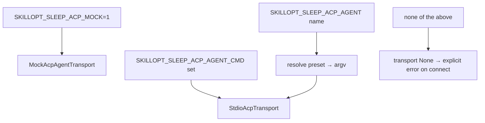

# PLAN — SkillOpt native ACP multi-agent

## Goal

Finish the fork-only native ACP adapter so SkillOpt-Sleep can drive **any** stdio ACP agent via named presets (cursor, devin, claude, custom), close 003 referee/crew nits, document behavior, and record per-agent prove JSON. No upstream SkillOpt PR, tags, or releases. Never set or require `ANTHROPIC_API_KEY` for the Claude path.

## Baseline (HEAD `241ca62`)

| Area | State |
|------|--------|
| Transport | `StdioAcpTransport` + `MockAcpAgentTransport` in `skillopt_sleep/acp_backend.py` |
| Selection today | `SKILLOPT_SLEEP_ACP_MOCK`, `SKILLOPT_SLEEP_ACP_AGENT_CMD` via `get_backend("acp")` |
| Contract tests | 12 tests in `tests/test_acp_backend_contract.py` (mock + single-chunk fixture) |
| Real prove (prior jobs) | cursor-agent + devin green on **desktop** pane; cursor FAIL under SSH BatchMode (keychain) |
| Product claim | Guardrail test + `plugins/acp/README.md` — not official plugin yet |

## Claude Code ACP adapter research (read-only)

| Package | Version (npm) | Launch (stdio) | Auth model | SkillOpt stance |
|---------|---------------|----------------|------------|-----------------|
| **`@agentclientprotocol/claude-agent-acp`** (current) | 0.107.0 | `claude-agent-acp` (Node global) or `npx -y @agentclientprotocol/claude-agent-acp`; optional [standalone release](https://github.com/agentclientprotocol/claude-agent-acp/releases) bundles `claude-agent-acp` + bundled `claude` CLI (`CLAUDE_CODE_EXECUTABLE` to override) | README: full smoke “needs a **Claude login**” (subscription/OAuth via Claude Code), not an API-key example | **Use this preset.** SkillOpt spawns the binary only; does **not** export `ANTHROPIC_API_KEY`. |
| **`@zed-industries/claude-code-acp`** (legacy) | 0.16.2 | `claude-code-acp` | README install snippet explicitly runs `ANTHROPIC_API_KEY=sk-... claude-code-acp` | **Do not** wire as default preset; document as legacy only. |

**Environment constraints:** no `claude` binary assumed on `PATH`; a Claude login directory may exist; the macOS login keychain is locked over SSH. Cursor and Claude proves need a desktop terminal, not an SSH batch shell.

**Claude prove ticket:** `blocked: needs-input` until (a) `claude-agent-acp` or standalone binary is on PATH and (b) interactive Claude Code subscription login works **without** injecting `ANTHROPIC_API_KEY`. If prove only succeeds with API key, stop and record blocker — do not add key to SkillOpt.

## Design — ACP agent registry

### Presets

| Name | Resolved argv (stdio agent) | Notes |
|------|----------------------------|--------|
| `cursor` | `cursor-agent acp` | Proven desktop; SSH BatchMode may fail (keychain). |
| `devin` | `devin acp` | Proven SSH + desktop (004). |
| `claude` | `SKILLOPT_SLEEP_ACP_CLAUDE_CMD` if set, else `npx -y @agentclientprotocol/claude-agent-acp@0.107.0` | Override env avoids hard-coding npx in tests/CI. Never add API key env. |
| `custom` | — | Requires explicit `SKILLOPT_SLEEP_ACP_AGENT_CMD`. |

### Resolution precedence (unchanged mock win; extend cmd source)



1. `use_mock` / `SKILLOPT_SLEEP_ACP_MOCK` → mock (wins over everything).
2. Non-empty `SKILLOPT_SLEEP_ACP_AGENT_CMD` → spawn as today (**back-compat**).
3. Non-empty `SKILLOPT_SLEEP_ACP_AGENT` (`cursor` | `devin` | `claude` | `custom`) → resolve to command string; `custom` without `AGENT_CMD` → clear error.
4. Else `transport=None`.

### Module placement

Add `skillopt_sleep/acp_agents.py` (or equivalent) with:

- `ACP_AGENT_PRESETS: dict[str, list[str]]` for fixed argv tails.
- `resolve_acp_agent_command(*, agent_name: str | None, agent_cmd: str | None, claude_cmd: str | None) -> str | None`.
- `list_acp_agent_names() -> tuple[str, ...]` for docs/tests.

Wire in `get_acp_backend()` and `get_backend("acp")` only — no new Sleep backend name.

### Nit fixes (003 referee + crew)

| # | Issue | Fix |
|---|--------|-----|
| 1 | `tokens_used()` always 0 | Increment proxy on each `agent_message_chunk` text length in `attempt()`; document as proxy not billing. Optionally expose `SKILLOPT_SLEEP_ACP_TOKENS_UNAVAILABLE=1` to force sentinel `-1` if we choose sentinel over proxy (prefer proxy for optimizer sanity). |
| 2 | `StdioAcpTransport.close()` bare `except` | `except subprocess.TimeoutExpired:` around `wait`; always attempt `kill()` on timeout or terminate failure path. |
| 3 | `_last_agent_text` O(n) | After `session/prompt`, scan transcript from `_chunk_scan_start` index only; reset index at prompt start. |
| 4 | `judge()` local-only | Document in `docs/skillopt-acp-adapter-plan.md` + `plugins/acp/README.md` — ACP v1 has no judge RPC; Sleep uses `exact_score` / `keyword_soft_score` locally. |

### Multi-chunk regression (commit `9b491a6`)

- Extend `tests/fixtures/acp_fixture_agent.py` with env `SKILLOPT_ACP_FIXTURE_SPLIT=1` emitting chunks `p` and `ong`.
- Contract test asserts assembled response contains full concatenation (locks chunk concat).

## Tests

| Layer | Command |
|-------|---------|
| ACP contract | `python -m pytest tests/test_acp_backend_contract.py -v` |
| New registry tests | `python -m pytest tests/test_acp_agent_registry.py -v` (new file) |
| Full PQC | `python -m pytest -q` → `research/pqc-<date>.txt` |

CI (`.github/workflows/ci.yml`): unchanged matrix; ACP tests stay hermetic (mock + fixture only). Real-agent prove is **not** in CI.

## Docs / README

- `plugins/acp/README.md`: multi-agent table, env vars (`SKILLOPT_SLEEP_ACP_AGENT`, `SKILLOPT_SLEEP_ACP_CLAUDE_CMD`), precedence, prove prerequisites (desktop keychain), Claude **login-not-API-key**.
- `docs/skillopt-acp-adapter-plan.md`: judge local-only, token proxy, registry.
- `docs/plans/skillopt-acp-multiagent-plan.md`: this plan (scrubbed paths).

## Per-agent prove protocol

Evidence JSON schema (store under job `research/` in worktree, **not** committed with host paths):

```json
{
  "agent": "cursor|devin|claude",
  "preset_or_cmd": "cursor",
  "env_note": "desktop pane | ssh batch",
  "status": "PASS|FAIL|BLOCKED",
  "sessionId": "...",
  "response": "pong",
  "hard": 1.0,
  "attempt_s": 0.0,
  "reason": "optional"
}
```

**Procedure (makers):**

1. `unset SKILLOPT_SLEEP_ACP_MOCK`
2. `export SKILLOPT_SLEEP_ACP_AGENT=<name>` (or `AGENT_CMD` for custom)
3. Minimal pong task (same as 003/004): intent “reply with the single word: pong”, reference exact `pong`
4. Run via small prove script or `skillopt-sleep --backend acp` one-shot — record timings + sessionId from transport transcript
5. **cursor-agent:** desktop terminal only (not SSH BatchMode; the keychain is locked there)
6. **claude:** only after T9 unblock; never export `ANTHROPIC_API_KEY`

Re-use 004 SUMMARY as baseline for cursor/devin re-record under this job’s `research/prove-*.json`.

## Lifecycle gates

| Stage | Gate |
|-------|------|
| Makers | One ticket per commit series; push fork branch |
| CI | Fork Actions must be enabled by the fork owner before CI runs |
| PQC | Local full pytest log in `research/pqc-*.txt` |
| Referee | Fresh composer-2.5; full diff `main..HEAD`; include 003 range a8d2b9d..241ca62 |
| Crew | Address actionable findings |
| Merge | Do not merge. Owner smoke via `SMOKE.md` first. No upstream PR. |

## Risks

| Risk | Mitigation |
|------|------------|
| Keychain locked over SSH | Document desktop-only prove; do not treat as adapter bug |
| Claude CLI missing on PATH | Standalone release tarball or `SKILLOPT_SLEEP_ACP_CLAUDE_CMD` |
| Legacy zed package implies API key | Default preset points at agentclientprotocol package |
| `tokens_used` proxy misleads optimizer | Docstring + README “proxy, not provider billing” |
| Fork CI disabled | PQC local mandatory; CI ticket blocked until enable |

## Ticket map

| ID | Summary |
|----|---------|
| T1 | Referee nits in `acp_backend.py` + judge doc |
| T2 | Multi-chunk fixture + regression test |
| T3 | `acp_agents.py` registry + resolve |
| T4 | Wire registry into `get_acp_backend` / tests |
| T5 | Claude preset + env override (no API key) |
| T6 | README + adapter plan docs |
| T7 | Prove cursor (desktop JSON) |
| T8 | Prove devin JSON |
| T9 | Prove claude (`needs-input` until login path verified) |

## Verification (planner)

- Read card, 003 referee, crew review, 004 prove SUMMARY
- Read `acp_backend.py`, contract tests, fixture, CI workflow
- npm view + upstream README for both Claude ACP packages (auth)
